<div align="center">


<a href="https://github.com/YOUR-USERNAME/telco-churn-supervised-learning">
  
</a>

<br/><br/>


<br/>


</div>

---

## 📌 Table of Contents

<details open>
<summary><b>Click to collapse / expand</b></summary>

1. [Overview](#-overview)
2. [Business Problem](#-business-problem)
3. [Pipeline](#-pipeline)
4. [Class Imbalance & SMOTE](#-class-imbalance--smote)
5. [Model Results](#-model-results)
6. [Key Findings](#-key-findings)
7. [Repository Structure](#-repository-structure)
8. [Quick Start](#-quick-start)
9. [Use the Saved Model](#-use-the-saved-model)
10. [Methodology Notes](#-methodology-notes)
11. [Roadmap](#-roadmap)
12. [Video Walkthrough](#-video-walkthrough)

</details>

---

## 🎯 Overview

An end-to-end supervised learning project that predicts **telecom customer churn** from the IBM Telco Customer Churn dataset (7,043 customers, 21 columns).

> [!NOTE]
> **`Churn = Yes`** means the customer left. **Recall on the churn class is the headline metric**, because every false negative is a customer the model failed to flag.

---

## 💼 Business Problem

| Metric | Why it matters |
|:--|:--|
| **CLV** — Customer Lifetime Value | Retention protects recurring revenue |
| **CAC** — Customer Acquisition Cost | Keeping a customer avoids paying to replace them |

Flag likely churners early → the retention team calls them **before** they leave.

---

## 🔄 Pipeline

<div align="center">

</div>

<details>
<summary><b>🧹 Data preparation details</b></summary>

<br/>

- `customerID` dropped (identifier, not a predictor)
- `TotalCharges`: text → numeric, blank strings → missing → imputed
- Engineered features: `tenure_group`, `num_services`, `AutoPay`
- Numeric features scaled, categorical features one-hot encoded
- Stratified 80 / 20 split, `random_state=42`

```mermaid
flowchart LR
    A[📥 Load Data] --> B[🧹 Clean & Engineer]
    B --> C[✂️ Stratified Split]
    C --> D[⚖️ SMOTE - train only]
    D --> E[🤖 Train 4 Models]
    E --> F[📊 Evaluate on Test Set]
    F --> G[🏆 Save Pipeline]
    G --> H[📞 Retention Actions]
    style D fill:#e67e22,color:#fff
    style F fill:#9b59b6,color:#fff
    style G fill:#2ecc71,color:#fff
```

</details>

<details>
<summary><b>🗺 Same flow as a Mermaid diagram</b></summary>



</details>

---

## ⚖️ Class Imbalance & SMOTE

More customers stay than leave, so a naive model can ignore churners. **SMOTE** creates synthetic churn examples — but **only in the training set**.

<div align="center">

</div>

> [!IMPORTANT]
> The test set keeps its **original** class distribution. Evaluating on synthetic customers would inflate every score.

---

## 🤖 Model Results

<div align="center">

</div>

<br/>

| Model | Accuracy | Precision | Recall | F1 | AUC-ROC | Train Time (s) |
|:--|--:|--:|--:|--:|--:|--:|
| **Gaussian NB** 🏆 | 0.7062 | 0.4696 | **0.8262** | 0.5988 | 0.8153 | 0.0039 |
| Decision Tree | 0.7523 | 0.5229 | 0.7647 | 0.6211 | **0.8329** | 0.0173 |
| KNN | 0.7012 | 0.4602 | 0.7273 | 0.5637 | 0.7651 | 0.0009 |
| SVM | **0.7601** | **0.5354** | 0.7273 | 0.6168 | 0.8195 | 9.2605 |

<details>
<summary><b>🏆 Recommendation</b></summary>

<br/>

**Gaussian Naive Bayes** caught the largest share of real churners (recall **0.826**). Trade-off: precision is **0.470**, so some flagged customers would have stayed anyway.

- Check flagged volume against the team's **daily call budget**
- Tune the probability threshold and run a **cost-based evaluation** before deployment
- **Decision Tree** → most interpretable, best AUC
- **SVM** → best accuracy / precision, but slowest (~9 s)

</details>

---

## 🔍 Key Findings

| Signal | What to check in the notebook |
|:--|:--|
| 📅 Month-to-month contracts | Contract-wise churn rate chart |
| ⏳ Short tenure | Tenure-group churn chart |
| 🧬 Top drivers | Decision Tree feature importance |
| ❌ Missed churners | False-negative profile |

Suggested retention experiments: targeted onboarding, proactive support, contract-specific offers — then **measure** whether churn actually drops.

---

## 📁 Repository Structure

```text
telco-churn-supervised-learning/
├── assets/                                  # Animated SVGs used in this README
│   ├── header.svg
│   ├── stats.svg
│   ├── pipeline.svg
│   ├── smote.svg
│   └── metrics.svg
├── CustomerChurn_SupervisedLearning.ipynb   # Tasks, explanations, code, plots
├── Telco-Customer-Churn.csv                 # Source dataset
├── churn_model.pkl                          # Fitted prediction pipeline
├── model_comparison.csv                     # Metrics table
├── summary_report.md                        # Business-facing report
├── requirements.txt
├── outputs/                                 # Saved comparisons & sample predictions
└── README.md
```

> [!WARNING]
> Make sure the CSV filename inside the notebook matches the file in this repo.

---

## 🚀 Quick Start

```bash
git clone https://github.com/YOUR-USERNAME/telco-churn-supervised-learning.git
cd telco-churn-supervised-learning
```

<table>
<tr><td><b>🪟 Windows</b></td><td><b>🍎 macOS / 🐧 Linux</b></td></tr>
<tr>
<td>

```bash
python -m venv .venv
.venv\Scripts\activate
```

</td>
<td>

```bash
python3 -m venv .venv
source .venv/bin/activate
```

</td>
</tr>
</table>

```bash
python -m pip install -r requirements.txt
python -m pip install notebook
python -m notebook
```

Open `CustomerChurn_SupervisedLearning.ipynb` → **Run All** cells top to bottom.

---

## 🧠 Use the Saved Model

```python
import joblib
import pandas as pd

model = joblib.load("churn_model.pkl")

new_customers = pd.read_csv("new_customers.csv")   # same raw columns as training

churn_probability = model.predict_proba(new_customers)[:, 1]
churn_flag = model.predict(new_customers)
```

---

## 🧪 Methodology Notes

> [!IMPORTANT]
> For the most rigorous evaluation, put **feature engineering → preprocessing → SMOTE → estimator** in a single `imbalanced-learn` pipeline and cross-validate on the original training split. This prevents leakage across folds.

---

## 🛣 Roadmap

- [x] Clean data and engineer features
- [x] SMOTE on training set only
- [x] Compare 4 models and save the pipeline
- [ ] Tune threshold around daily call capacity
- [ ] Leakage-safe cross-validation with SMOTE inside a pipeline
- [ ] Cost-based evaluation (missed churner vs wasted call)
- [ ] Drift monitoring and campaign outcome tracking
- [ ] Serve the pipeline via a controlled prediction API

---

## 🎥 Video Walkthrough

<!-- Replace with your Google Drive / unlisted YouTube URL -->
▶️ **[Watch the 5–10 minute project explanation](PASTE-YOUR-VIDEO-URL-HERE)**

---

<div align="center">

**Made with ❤️, Python and scikit-learn**

⭐ Star the repo if it helped you!


</div>
